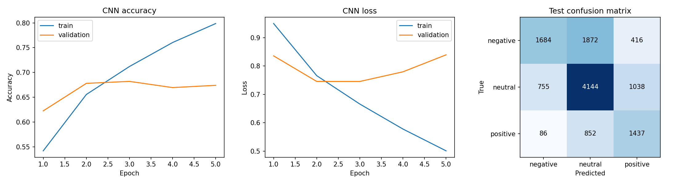

# Evaluating neural networks through metrics analysis

Reproducible comparison of dense, convolutional (CNN), and recurrent (LSTM)
neural networks for **three-class English Twitter sentiment analysis**.
All three models were trained from scratch on the public
[TweetEval sentiment dataset](https://github.com/cardiffnlp/tweeteval/tree/main/datasets/sentiment).
The repository includes the trained models, executed notebook, metrics, plots,
and an inference command.

## Interactive dashboard

**Live on Vercel: [neural-metrics-lab.vercel.app](https://neural-metrics-lab.vercel.app)**

The responsive dashboard in `dashboard/` includes model comparison, all evaluation
metrics, training/validation accuracy and loss curves, normalized confusion
matrices, per-class reports, test ROC curves, class distributions, provenance,
CSV export, and a live sentiment playground using the trained dense model.

The prediction runs entirely in the browser using the exported learned weights,
not a simulated response or external API. JavaScript predictions are tested against
the original TensorFlow outputs with a tolerance of `2e-6`. Blank input is rejected.
The dashboard is static, so it runs on Vercel without a Python server.

```powershell
# Refresh the dashboard after retraining (requires the Python environment above).
.\.venv\Scripts\python.exe scripts/build_dashboard.py
node --test dashboard/tests/inference.test.mjs

# Preview at http://localhost:8846
python -m http.server 8846 --directory dashboard

# Deploy on your connected Vercel account
vercel deploy dashboard --project neural-metrics-lab --prod --yes
```

Dashboard data is exported from `artifacts/`; raw dataset tweets are not published.
The dense model's exported vocabulary and weights are public as part of the demo.
Run `scripts/build_dashboard.py` again whenever models or recorded metrics change.

## Retraining results

Actual CPU run on **6 November 2026**, Python 3.12.10, TensorFlow 2.20.0, seed 42.
After duplicate/overlap cleaning: **45,582 training**, **2,000 validation**, and
**12,284 test** tweets. The test set was left unchanged.

| Model | Validation macro F1 | Test accuracy | Test macro F1 | Best epoch / epochs run |
|---|---:|---:|---:|---:|
| Dense | 0.6477 | 56.94% | 0.5683 | 3 / 5 |
| CNN | 0.6446 | 59.14% | 0.5705 | 3 / 5 |
| LSTM | 0.6318 | 58.66% | 0.5804 | 2 / 4 |

The majority-class baseline predicts neutral: **48.33% test accuracy**, **0.2172
macro F1**. Dense is the default model because it has the highest **validation
macro F1**. CNN leads on test accuracy and LSTM on test macro F1, but the test set
does not choose the default. Within each run, early stopping restores the epoch
with the lowest validation loss (patience 2, at most 8 epochs).

These are small baseline models with meaningful room for improvement. Results
are from one seeded run, not a claim of statistical significance or state-of-the-art
performance. The three-class task and new dataset differ from the old notebook's
positive-versus-other task, so historical accuracies are not directly comparable.



## Setup and retrain

Use **Python 3.12**. On Windows PowerShell:

```powershell
py -3.12 -m venv .venv
.\.venv\Scripts\python.exe -m pip install -r requirements-dev.txt
.\.venv\Scripts\python.exe train.py
.\.venv\Scripts\python.exe -m pytest -q
```

On Linux/macOS, use `python3.12 -m venv .venv` and `.venv/bin/python` in the
equivalent commands. `requirements.txt` contains runtime dependencies;
`requirements-lock.txt` records all exact package versions from the completed run.
Use the lock file instead of the dev requirements to recreate that environment.
Seeds and deterministic TensorFlow operations are enabled; results can still vary
across TensorFlow versions and hardware.

The first run downloads six small UTF-8 dataset files from an immutable upstream
commit, verifies SHA-256 hashes, and caches them in ignored `data/`. It learns a
15,000-token vocabulary on training text only and uses trainable 64-dimensional
embeddings with sequences of 64 tokens. Negation words are retained. No GloVe,
Kaggle credentials, or manually supplied CSV is needed.

`python train.py --help` lists all options. For a quick integration check, write
to a separate directory so the committed full-run artifacts remain available:

```powershell
.\.venv\Scripts\python.exe train.py --models dense --epochs 1 --limit-train 600 --output artifacts/smoke
```

The small networks are revised versions of the original model families: dense
uses masked average pooling and a 64-unit hidden layer, CNN uses 64 filters of
width 3 and max pooling, and LSTM uses 32 recurrent units. Each has dropout 0.4
and a three-way softmax output. All use Adam and sparse categorical cross-entropy.
Architecture and preprocessing choices were fixed before the test evaluation.

## Predict sentiment

```powershell
.\.venv\Scripts\python.exe predict.py "I loved this!" "This was awful."
.\.venv\Scripts\python.exe predict.py --model artifacts/cnn.keras "A new tweet"
```

The first command uses the validation-selected model from `artifacts/summary.json`.
Each `.keras` file bundles its vocabulary and preprocessing, accepts raw strings,
and returns probabilities in the order **negative, neutral, positive**. Neural
network softmax scores are not calibrated confidence estimates.

## Files and verification

- `Sentiment Analysis.ipynb`: executed evaluation, plots, and prediction example.
  By default it reads committed results. Set `RUN_TRAINING = True` to retrain.
  Select the Python environment with `requirements-dev.txt` installed.
- `train.py` / `predict.py`: downloadable-data training pipeline and inference CLI.
- `DATASET.md` / `dataset_checksums.json`: source, attribution, terms, and checksums.
- `artifacts/{dense,cnn,lstm}.keras`: trained models with text vectorizers.
- `artifacts/metrics.json`: validation/test accuracy, macro precision/recall/F1,
  weighted F1, multiclass one-vs-rest macro ROC AUC, log loss, per-class reports,
  confusion matrices, and training times.
- `artifacts/*_test_predictions.npz`: test labels and probabilities for independent
  metric recalculation, in the official test order.
- `artifacts/*_history.json` and `*_evaluation.png`: complete learning curves and plots.
- `artifacts/config.json`, `dataset_manifest.json`, `vocabulary.json`, and
  `summary.json`: exact configuration, split counts, provenance, and selection.
- `tests/test_training.py`: leakage/duplicate handling, metric interpretation,
  and an optimization step plus save/load equivalence for all three architectures.
  GitHub Actions runs these tests without downloading or retraining on the full dataset.

All three full-run models were saved and reloaded, with predictions checked against
the original model. The notebook was executed end to end against these artifacts.
The original notebook remains accessible in Git history.

Historical English tweets, class/temporal distribution differences, sarcasm, and
simple punctuation normalization limit generalization. A neutral sentence may be
misclassified as positive; see the notebook example. Emoji and hashtag information
can be lost by the standardizer. See [DATASET.md](DATASET.md) for details.
